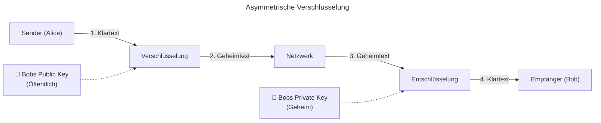

# M231 Lernjournal

### Ylli Uka

### PE26a

### Tag 7

### 19.10.26
---

## Verschlüsselungsverfahren


```mermaid

title: Symmetrische Verschlüsselung 
---
flowchart LR
    A["Sender (Alice)"] -- "1. Klartext" --> V["Verschlüsselung"]
    K["🔑 Geheimer Schlüssel (K)\n(Gemeinsamer Schlüssel)"] -.-> V
    V -- "2. Geheimtext" --> N["Unsicheres Netzwerk"]
    N -- "3. Geheimtext" --> E["Entschlüsselung"]
    K -.-> E
    E -- "4. Klartext" --> B["Empfänger (Bob)"]
```




## Integritätsprüfung mit PowerShell (Hashwerte)

### **Erklärung & Ziel**
Um sicherzustellen, dass eine Datei bei der Übertragung nicht verändert oder beschädigt wurde (**Integritätsprüfung**), wird ein kryptografischer **Hashwert** (Fingerabdruck) berechnet. Ändert sich die Datei auch nur minimal, verändert sich der Hashwert komplett.

### **Durchführung**
In der Windows PowerShell wurde der MD5-Hashwert für die Datei `Gebäudeplan.png` ermittelt:

```powershell
Get-FileHash "C:\Users\yiua\Downloads\Gebäudeplan.png" -Algorithm MD5
```

**Ausgabe / Ergebnis:**
* **Algorithmus:** MD5
* **Hash-Wert:** `95ADEF958BB3081AAD876D55B0F6357D`
* **Datei-Pfad:** `C:\Users\yiua\Downloads\Gebäudeplan.png`

### **Nachweis (Screenshot)**

```


