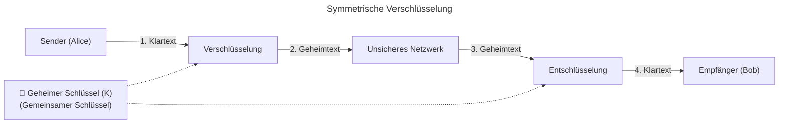
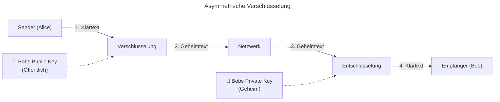

# M231 Lernjournal

### Ylli Uka

### PE26a

### Tag 7

### 19.10.26
---

## Verschlüsselungsverfahren







## Integritätsprüfung mit PowerShell (Hashwerte)

### **Erklärung & Ziel**
Um sicherzustellen, dass eine Datei bei der Übertragung nicht verändert oder beschädigt wurde (**Integritätsprüfung**), wird ein kryptografischer **Hashwert** (Fingerabdruck) berechnet. Ändert sich die Datei auch nur minimal, verändert sich der Hashwert komplett.

### **1. Durchführung**
In der Windows PowerShell wurde der MD5-Hashwert für die Datei `Gebäudeplan.png` ermittelt:

```powershell
Get-FileHash "C:\Users\yiua\Downloads\Gebäudeplan.png" -Algorithm MD5
```

**Ausgabe / Ergebnis:**
* **Algorithmus:** MD5
* **Hash-Wert:** `95ADEF958BB3081AAD876D55B0F6357D`
* **Datei-Pfad:** `C:\Users\yiua\Downloads\Gebäudeplan.png`


---
### **2. Durchführung**
In der Windows PowerShell wurde der MD5-Hashwert für die Datei `Hallo.vbs` ermittelt:
Get-FileHash "C:\Users\yiua\OneDrive - Bellini Personal AG\Desktop\hallo.vbs" -Algorithm MD5

**Ausgabe / Ergebnis:**

* **Algorithmus:** MD5
* **Hash-Wert:** FB888618B9B15712532FD36B33C5C14A
* **Datei-Pfad:** C:\Users\yiua\OneDrive - Bellini Personal AG\Desktop\hallo.vbs


# Was habe ich heute gelernt?

* **Symmetrische Verschlüsselung:** Ein gemeinsamer Schlüssel für Ver- und Entschlüsselung (schnell, aber Schlüsselaustausch ist schwierig).
* **Asymmetrische Verschlüsselung:** Schlüsselpaar aus Public Key (zum Verschlüsseln) und Private Key (zum Entschlüsseln).
* **Hashwerte (PowerShell):** Überprüfung der Datei-Integrität mittels `Get-FileHash` (z. B. MD5 / SHA256).
* **Lernjournal-Review mit Linus Gätzi:** Erfolgreich erledigt! Wir eide hatten ein gutes strukturiertes Journal.
